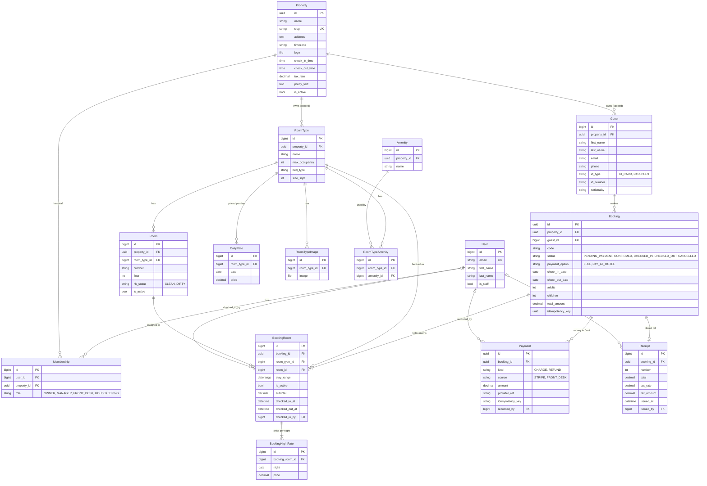

# ERD (TASK-62)

สร้างจาก model จริงใน `main` (`django.apps.apps.get_models()` ของ app `properties`, `rooms`, `bookings`)
ถ้าแก้ model ให้แก้ไฟล์นี้ใน PR เดียวกัน

ตารางข้อมูลดำเนินงานทุกตารางสืบทอด `PropertyScopedModel` จึงมี FK `property` ไปที่ `Property`
ในแผนภาพละเส้น `property` ของตารางเหล่านี้ไว้ และแสดงเฉพาะ field หลัก
(ไม่มี เช่น `Property.max_rooms`, `max_staff`, `RoomType.description`, `Booking.created_at`, `cancelled_at`)
เพื่อให้อ่านความสัมพันธ์หลักได้ง่าย field ครบอยู่ใน `models.py` ของแต่ละ app
([ADR 0002](../adr/0002-one-database-scoped-by-property.md))

## Constraint ที่สำคัญ

กฎเหล่านี้บังคับที่ฐานข้อมูล ไม่ใช่แค่ใน Python จึงยังป้องกันได้แม้มีคำขอพร้อมกัน

| ตาราง | Constraint | ความหมาย |
| --- | --- | --- |
| BookingRoom | `bookings_bookingroom_no_overlap` (ExclusionConstraint: `room =`, `stay_range &&`) | ห้องเดียวกันมีช่วงเข้าพักที่ทับกันไม่ได้ มีผลเฉพาะแถว `is_active=True` (ยกเลิกหรือปล่อยห้องแล้วไม่กัน) ([ADR 0003](../adr/0003-prevent-double-booking.md)) ช่วงเป็น `[check_in, check_out)` เช็คเอาต์และเช็คอินวันเดียวกันจึงไม่ทับ |
| Booking | unique (`property`, `code`), unique (`property`, `idempotency_key`), check-out หลัง check-in, ผู้ใหญ่อย่างน้อย 1, ยอดไม่ติดลบ | รหัสการจองไม่ซ้ำในโรงแรม และกดส่งซ้ำไม่ได้การจองสองรายการ |
| BookingNightRate | unique (`property`, `booking_room`, `night`) | ราคาของแต่ละคืนบันทึกไว้ครั้งเดียวตอนจอง ([ADR 0004](../adr/0004-money-and-append-only-payments.md)) |
| Payment | unique (`property`, `provider_ref`), unique (`property`, `idempotency_key`), ยอดมากกว่า 0 | webhook ที่ Stripe ส่งซ้ำ หรือการกดซ้ำ ไม่สร้างรายการเงินซ้ำ |
| Receipt | unique (`property`, `number`), unique (`property`, `booking`), VAT ไม่เกินยอดรวม | เลขที่ใบเสร็จเรียงต่อโรงแรม และปิดบิลได้ครั้งเดียวต่อการจอง |
| Guest | unique (`property`, lower(`email`)) | แขกหนึ่งอีเมลต่อโรงแรม |
| Room, RoomType, Amenity, DailyRate | unique ที่รวม `property` เสมอ (เลขห้อง, ชื่อประเภท, ชื่อสิ่งอำนวยความสะดวก, ราคาต่อวัน) | ต่างโรงแรมใช้ชื่อหรือเลขซ้ำกันได้ (AGENTS.md ข้อ 5) |
| Membership | unique (`user`, `property`) | หนึ่งคนมีได้หนึ่ง role ต่อโรงแรม |

`Property` และ `Booking` ใช้ UUID เป็น primary key (AGENTS.md ข้อ 7) เพื่อไม่ให้เดาลำดับจาก URL ได้
`Payment` และ `Receipt` แก้หรือลบไม่ได้หลังสร้าง (`save()` และ `delete()` ปฏิเสธ)
