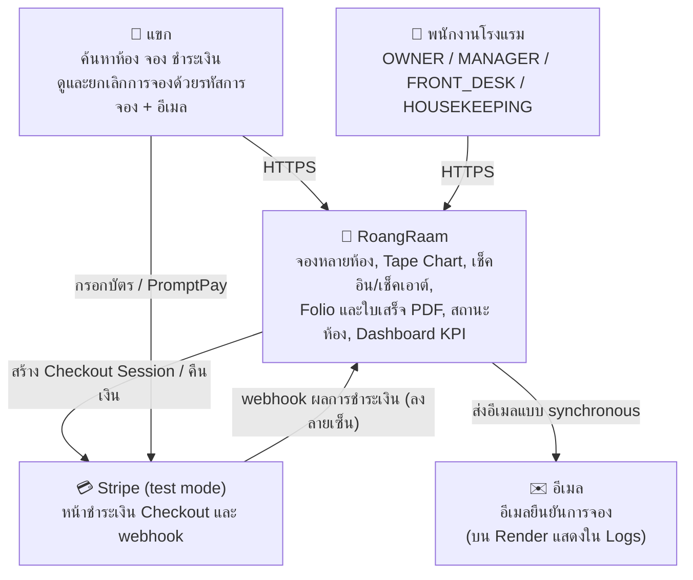
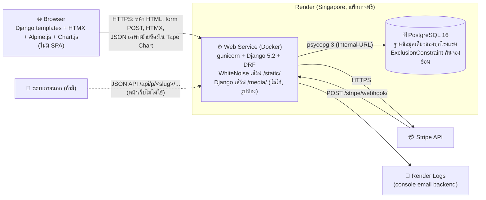
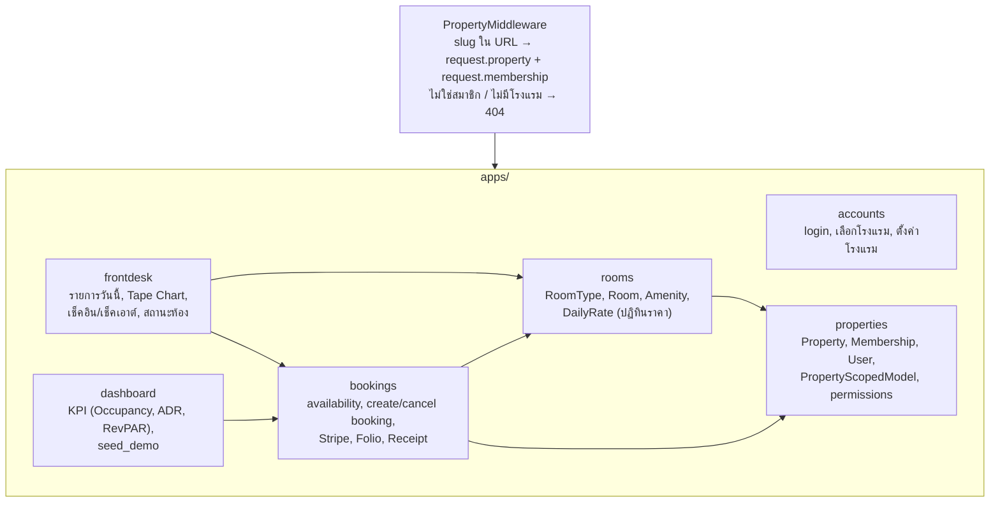

# สถาปัตยกรรมระบบ RoangRaam (TASK-62)

ระบบบริหารโรงแรมหลายแห่งในระบบเดียวและฐานข้อมูลเดียว ข้อมูลของแต่ละโรงแรมแยกจากกัน
เอกสารชุดนี้ใช้แบบจำลอง C4 สองระดับแรก (Context และ Container) ส่วนโครงสร้างข้อมูลอยู่ใน [ERD.md](ERD.md)
และเหตุผลของการตัดสินใจสำคัญอยู่ใน [ADR](../adr/README.md)

## 1. System Context

ใครใช้ระบบ และระบบคุยกับระบบภายนอกใดบ้าง

| ผู้ใช้ | สิ่งที่ทำ | ต้องล็อกอิน |
| --- | --- | --- |
| แขก | ค้นหาห้องว่าง จองหลายห้องในบิลเดียว ชำระออนไลน์หรือที่โรงแรม ยกเลิกการจอง | ไม่ต้อง (หน้า `/p/<slug>/...` แบบ public) |
| OWNER | ทุกอย่างของโรงแรมตัวเอง และเทียบ KPI ข้ามโรงแรมที่เป็นเจ้าของ | ต้อง |
| MANAGER | ห้องและราคา, งานหน้าเคาน์เตอร์, Dashboard, ตั้งค่าโรงแรม | ต้อง |
| FRONT_DESK | รายการวันนี้, Tape Chart, เช็คอิน/เช็คเอาต์, Folio, สถานะห้อง | ต้อง |
| HOUSEKEEPING | สถานะห้อง (เปลี่ยน Dirty เป็น Clean) | ต้อง |

สิทธิ์ละเอียดของทุก URL อยู่ใน [PERMISSIONS.md](../project/PERMISSIONS.md)

## 2. Container

ส่วนที่ deploy จริง และการสื่อสารระหว่างกัน

| Container | เทคโนโลยี | หน้าที่ |
| --- | --- | --- |
| Browser | Django templates, HTMX, Alpine.js, Chart.js (CDN) | แสดงผลจาก server; JavaScript ใช้เฉพาะส่วนโต้ตอบ เช่น ลากใน Tape Chart, dialog เช็คอิน, กราฟ KPI |
| Web Service | Python 3.12, Django 5.2, DRF, gunicorn, WhiteNoise | business logic ทั้งหมด, ตรวจสิทธิ์, แยกข้อมูลตามโรงแรม, สร้างใบเสร็จ PDF (fpdf2) ตอนขอดู ไม่เก็บเป็นไฟล์ |
| PostgreSQL 16 | Render Managed PostgreSQL | เก็บข้อมูลทุกโรงแรม; constraint ระดับฐานข้อมูลเป็นด่านสุดท้ายของกฎสำคัญ |
| Stripe | Checkout Session + webhook | รับชำระออนไลน์ (บัตร / PromptPay) และคืนเงินตอนยกเลิก |

ตอนเริ่ม container `scripts/start.sh` จะรัน migrate, สร้างข้อมูลเดโมถ้าตั้ง `SEED_ON_START`,
สร้างบัญชี admin แล้วเปิด gunicorn การตั้งค่าและข้อจำกัดของแพ็กเกจฟรีอยู่ใน [DEPLOY.md](../project/DEPLOY.md)

ตอนพัฒนาใช้ `docker-compose.yml` (Django runserver + PostgreSQL 16) โครงสร้างเดียวกันแต่ไม่มี gunicorn

## 3. ภายใน Web Service

Django แบ่งเป็น app ตามขอบเขตงาน แต่ละ app เก็บ business logic ไว้ใน service ไม่ใช่ใน view
([ADR 0001](../adr/0001-modular-monolith.md))

| App | เจ้าของ | service หลัก |
| --- | --- | --- |
| `properties` | A | `PropertyScopedModel`, `Model.scoped.for_property()`, `role_required` |
| `rooms` | D | `apps/rooms/services.py` (ปฏิทินราคา, bulk update) |
| `bookings` | A (การจอง), C (ชำระเงิน, Folio, ใบเสร็จ) | `services.py`, `payments.py`, `folio.py`, `receipt_pdf.py` |
| `frontdesk` | D (Tape Chart), A/B (เช็คอิน/เช็คเอาต์), E (รายการวันนี้) | `services/tape_chart*.py`, `services/check_in_out.py`, `services/daily_ops.py`, `services/room_status.py` |
| `dashboard` | E | `services.py` (`kpi_summary`, `daily_revenue`, `hotel_comparison`), `seed.py` |
| `accounts` | C (ตั้งค่าโรงแรม) และทีม | หน้า login, หน้าเลือกโรงแรม, ตั้งค่าโรงแรม |

หน้าเว็บส่งข้อมูลด้วย form และ HTMX ไปที่ view ปกติ ส่วนที่เรียกเป็น JSON มีแค่การย้ายห้องใน Tape Chart
JSON API ใต้ `/api/p/<slug>/...` (ค้นหาห้องว่าง, สร้างการจอง) มีให้แยกแต่หน้าเว็บไม่ได้ใช้
รายละเอียดอยู่ใน [API_CONTRACT.md](../project/API_CONTRACT.md)
