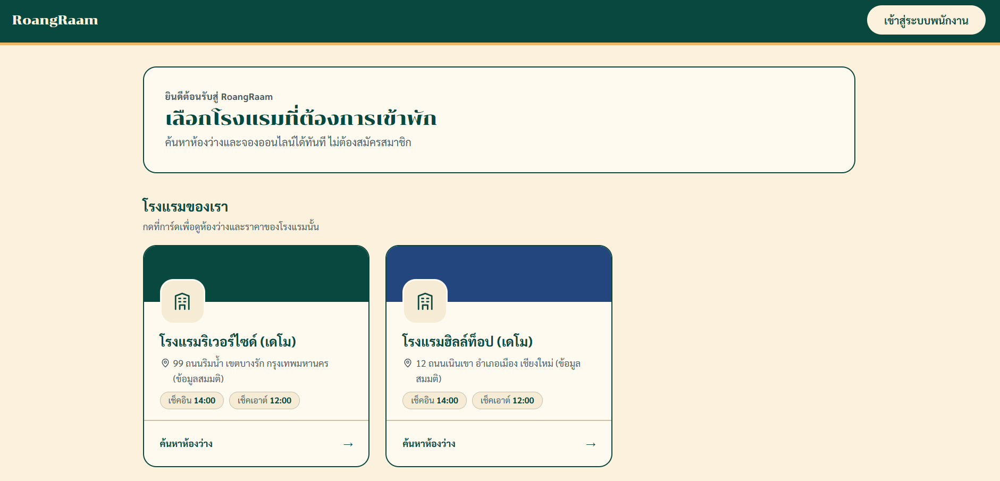
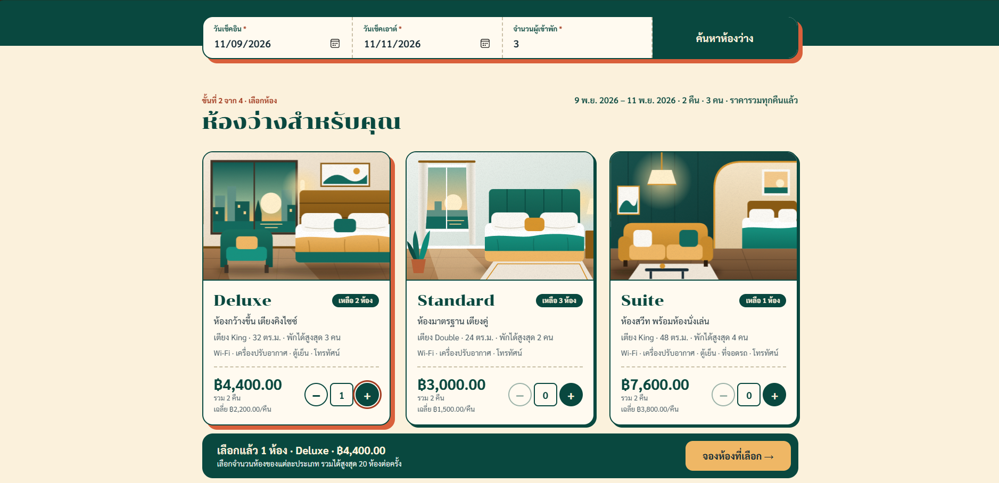
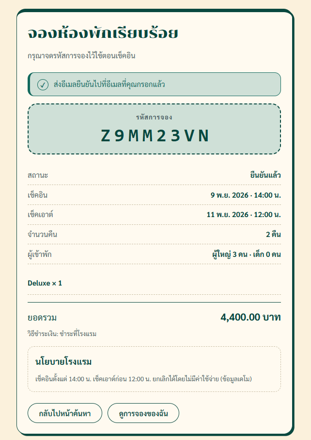
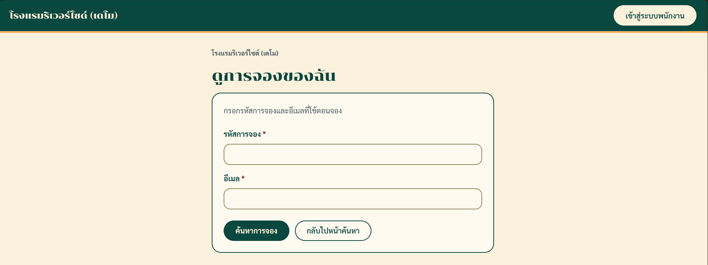
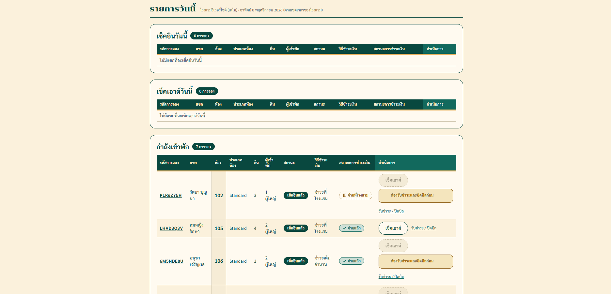
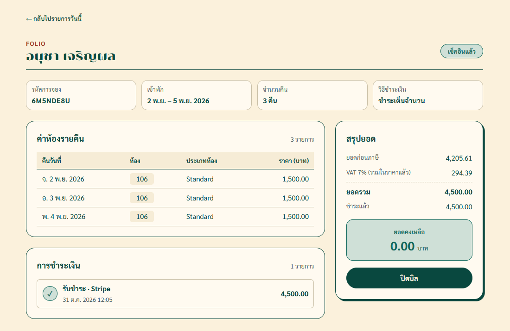
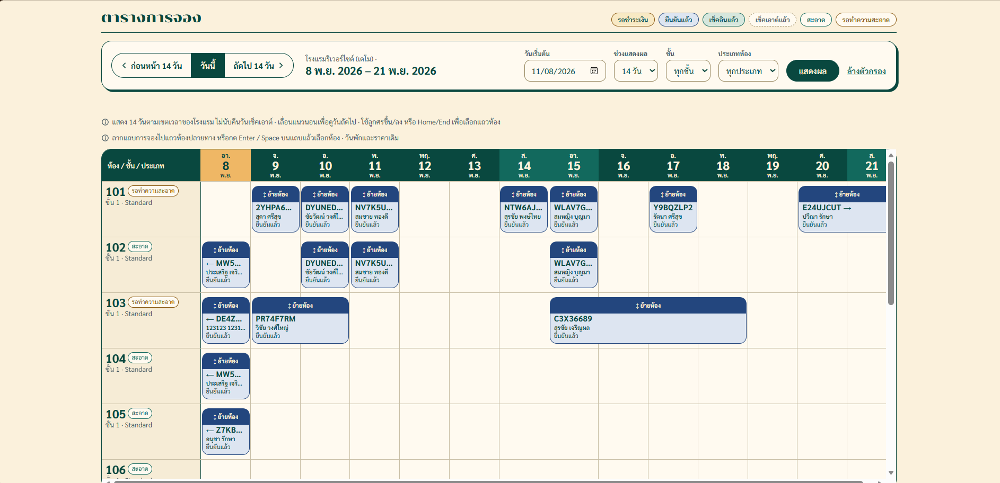
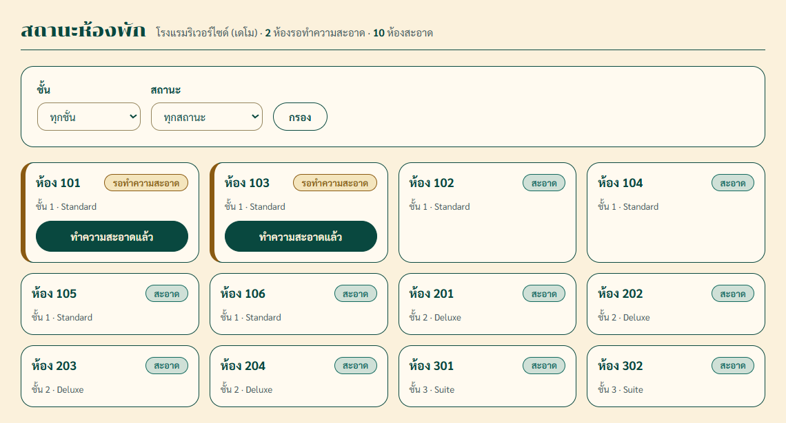
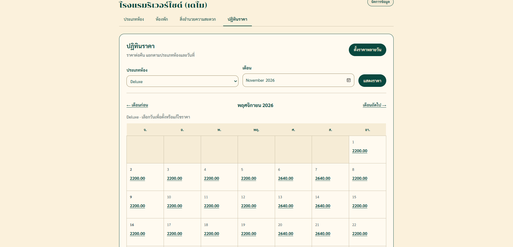
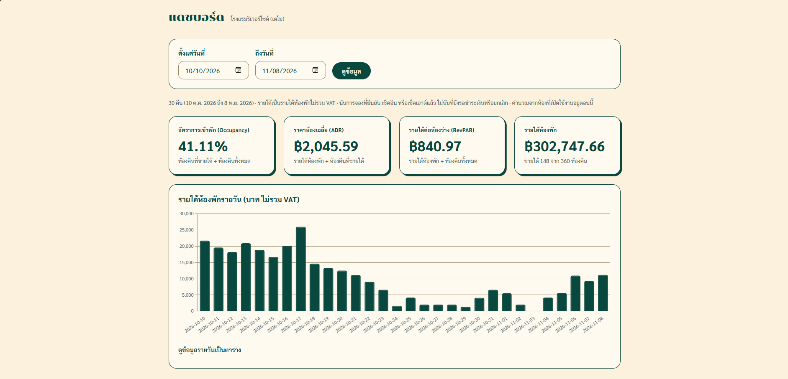

# คู่มือการใช้งาน RoangRaam (TASK-64)

คู่มือสั้นสำหรับแขกและพนักงานโรงแรม แบ่งตามบทบาท บทบาทละไม่กี่ขั้น
ภาพทั้งหมดถ่ายจากระบบเดโมบน Render ด้วยข้อมูลสมมติ

## เริ่มต้น

- **เว็บ:** https://roangraam.onrender.com/
- หน้าแรกแสดงรายชื่อโรงแรม กดการ์ดโรงแรมเพื่อค้นหาห้องว่าง แขกจองได้โดยไม่ต้องสมัครสมาชิก
- พนักงานกดปุ่ม **เข้าสู่ระบบพนักงาน** มุมขวาบน แล้วใช้อีเมลที่ได้จากเจ้าของหรือผู้จัดการ
  บัญชีเดโมอยู่ใน [README](../../README.md#บัญชีเดโม) (รหัสผ่านขอจากทีม ไม่เขียนในเอกสาร)
- ระบบเดโมใช้ Render แพ็กเกจฟรี ถ้าไม่มีคนใช้สักพัก เปิดครั้งแรกอาจรอประมาณ 1 นาที

## 1. แขก: จองห้อง ชำระเงิน และยกเลิก

1. เลือกโรงแรมจากหน้าแรก ใส่ **วันเช็คอิน**, **วันเช็คเอาต์** และ **จำนวนผู้เข้าพัก** แล้วกด **ค้นหาห้องว่าง**
2. ระบบแสดงเฉพาะห้องที่ว่างตลอดช่วงวันที่เลือก พร้อมราคารวมและราคาเฉลี่ยต่อคืน
   กดปุ่ม **+ / −** เลือกจำนวนห้องของแต่ละประเภท (จองหลายห้องในครั้งเดียวได้) แล้วกด **จองห้องที่เลือก**

   

3. กรอก **ข้อมูลผู้เข้าพัก** และเลือก **วิธีชำระเงิน**
   - **ชำระที่โรงแรม:** ยืนยันการจองทันที ชำระเมื่อเข้าพัก
   - **ชำระเต็มจำนวน:** ไปหน้าชำระเงินของ Stripe (ระบบเดโมใช้บัตรทดสอบ `4242 4242 4242 4242`)
4. กด **ยืนยันการจอง** จะได้หน้า **จองห้องพักเรียบร้อย** พร้อม **รหัสการจอง** จดรหัสนี้ไว้ใช้ดูหรือยกเลิกการจอง
   ระบบส่งอีเมลยืนยันด้วย (ในระบบเดโมอีเมลไม่ได้ส่งจริง แต่บันทึกไว้ใน log ของเซิร์ฟเวอร์)

   

5. **ดูหรือยกเลิกการจอง:** ที่หน้าค้นหากด **ดูการจองของฉัน** ใส่รหัสการจองกับอีเมลที่ใช้จอง แล้วกด **ค้นหาการจอง**
   - กด **ยกเลิกการจอง** แล้ว **ยืนยันการยกเลิก** ไม่มีค่าปรับ และห้องกลับมาให้คนอื่นจองได้ทันที
   - ถ้าเลือกชำระออนไลน์แต่ยังจ่ายไม่สำเร็จ กด **ชำระเงิน** เพื่อจ่ายใหม่ได้

   

## 2. พนักงานต้อนรับ: เช็คอิน ย้ายห้อง รับชำระ และเช็คเอาต์

หลังเข้าสู่ระบบ เลือกโรงแรม แล้วใช้เมนูด้านบน

### รายการวันนี้

หน้า **รายการวันนี้** แบ่งเป็น 3 ส่วน: **เช็คอินวันนี้**, **เช็คเอาต์วันนี้** และ **กำลังเข้าพัก**

**เช็คอิน**
1. ในส่วน **เช็คอินวันนี้** กด **เช็คอิน** ที่การจองของแขก
2. เลือก **ประเภทเอกสาร** กรอก **เลขที่เอกสาร** (บัตรประชาชนต้องเป็นตัวเลข 13 หลัก) และ **สัญชาติ** ถ้ามี แล้วกด **ยืนยันเช็คอิน**
3. ถ้าระบบขึ้นว่า **เช็คอินไม่ได้ เพราะ:** ห้องยังไม่สะอาด หรือแขกเดิมยังไม่เช็คเอาต์
   กด **ไปหน้าสถานะห้อง** เพื่อตรวจ แล้วกลับมาเช็คอินใหม่

**รับชำระ ปิดบิล และเช็คเอาต์**
1. ในส่วน **เช็คเอาต์วันนี้** กด **รับชำระ / ปิดบิล** เพื่อเปิด Folio ของการจอง
2. Folio แสดงค่าห้องรายคืน ยอดที่ชำระแล้ว และยอดคงเหลือ
   ถ้ามียอดค้าง กด **รับชำระ ... บาท** (การจองที่จ่ายออนไลน์แล้วจะมียอดคงเหลือเป็น 0)
3. กด **ปิดบิล** จะได้ **ใบเสร็จเลขที่** และดาวน์โหลดใบเสร็จ PDF ได้ (ยอดรวม VAT ตามที่ตั้งไว้ในโรงแรม)

   

4. กลับไปหน้ารายการวันนี้ แล้วกด **เช็คเอาต์** ห้องจะเปลี่ยนเป็น **รอทำความสะอาด** ทันที
   ปุ่มเช็คเอาต์กดไม่ได้จนกว่าจะรับชำระครบและปิดบิล

### ตารางการจอง (ย้ายห้อง)

หน้า **ตารางการจอง** แสดงห้องทั้งหมดเป็นแถว และวันที่เป็นคอลัมน์ การจองแต่ละรายการเป็นแถบ สีของแถบบอกสถานะตามคำอธิบายด้านบนตาราง
เลือก **วันเริ่มต้น** และ **ช่วงแสดงผล** กดกลับมา **วันนี้** และกรองตาม **ชั้น** หรือ **ประเภทห้อง** ได้

1. ลากแถบการจองไปวางในแถวของห้องอื่น (บนแท็บเล็ตใช้นิ้วลากได้)
   หรือใช้คีย์บอร์ด: เลือกแถบการจองแล้วกด Enter หรือ Space จากนั้นเลือกห้องปลายทาง
2. ย้ายได้เฉพาะห้อง **ประเภทเดียวกัน** ที่ **ว่างตลอดช่วงวันพัก** วันพักและราคาไม่เปลี่ยน
3. ย้ายไม่ได้ถ้าห้องปลายทางไม่ว่าง เป็นคนละประเภท หรือแขกเช็คอินแล้ว ระบบจะบอกเหตุผล
   ถ้าเปลี่ยนใจระหว่างย้าย กด **ยกเลิกการย้าย**

## 3. แม่บ้าน: สถานะห้อง

แม่บ้านเห็นเมนูเดียวคือ **สถานะห้อง**

1. ห้องที่ **รอทำความสะอาด** อยู่บนสุด ใช้ **กรอง** ตามชั้นหรือสถานะเพื่อดูเฉพาะห้องที่ต้องทำ
2. ทำความสะอาดเสร็จแล้ว กด **ทำความสะอาดแล้ว** ห้องจะเปลี่ยนเป็น **สะอาด** และตัวเลขสรุปด้านบนเปลี่ยนตาม
   พนักงานต้อนรับเช็คอินห้องนั้นได้ทันที

## 4. ผู้จัดการ: ห้องพัก ราคา และตั้งค่าโรงแรม

**ห้องพักและราคา:** จากหน้าแรกของโรงแรม กดการ์ด **ห้องพักและราคา** จะมีแท็บ
**ประเภทห้อง**, **ห้องพัก**, **สิ่งอำนวยความสะดวก** และ **ปฏิทินราคา**

1. เพิ่ม แก้ไข หรือลบประเภทห้อง ห้อง และสิ่งอำนวยความสะดวก
   ลบไม่ได้ถ้ามีข้อมูลอื่นใช้อยู่ เช่น ห้องที่มีการจอง ระบบจะบอกเหตุผล
2. **ปฏิทินราคา:** เลือกประเภทห้องกับเดือน แล้วกด **แสดงราคา**
   - กดวันในปฏิทินเพื่อตั้งราคาวันเดียว
   - กด **ตั้งราคาหลายวัน** เพื่อตั้งราคาเดียวกันทั้งช่วงวันที่ เช่น ช่วงปีใหม่
   - วันที่ขึ้นว่า **ยังไม่ตั้งราคา** แขกจะจองไม่ได้ ระบบไม่มีราคาเริ่มต้นแทนให้
   - ราคาคิดเป็นรายคืน การพักข้ามช่วงราคาจะคิดตามราคาของแต่ละคืน และการเปลี่ยนราคาไม่กระทบการจองเดิม

   

**ตั้งค่าโรงแรม:** เมนู **ตั้งค่าโรงแรม** ใช้แก้โลโก้ (**เลือกรูปโลโก้**) เวลาเช็คอินและเช็คเอาต์ อัตรา VAT และนโยบายโรงแรม
แล้วกด **บันทึกการตั้งค่า** ดูผลบนหน้าลูกค้าได้จากลิงก์ **ดูหน้าจองของลูกค้า ↗**

## 5. เจ้าของ: แดชบอร์ดและเปรียบเทียบโรงแรม

1. เมนู **แดชบอร์ด** แสดง Occupancy, ADR, RevPAR และกราฟรายได้ห้องพักของโรงแรมที่เลือก เปลี่ยนช่วงวันที่ได้
2. กด **เปรียบเทียบโรงแรม** เพื่อดูตัวเลขของทุกโรงแรมที่เป็นเจ้าของคู่กัน (ผู้จัดการไม่เห็นปุ่มนี้)
3. สลับโรงแรมได้จากปุ่มเลือกโรงแรมมุมขวาบน

## สิทธิ์ตามบทบาท

| เมนู | เจ้าของ | ผู้จัดการ | พนักงานต้อนรับ | แม่บ้าน |
| --- | :-: | :-: | :-: | :-: |
| รายการวันนี้ (เช็คอิน / เช็คเอาต์ / Folio) | ✓ | ✓ | ✓ | |
| ตารางการจอง | ✓ | ✓ | ✓ | |
| สถานะห้อง | ✓ | ✓ | ✓ | ✓ |
| ห้องพักและราคา (ดู) | ✓ | ✓ | ✓ | |
| ห้องพักและราคา (แก้ไข) | ✓ | ✓ | | |
| ตั้งค่าโรงแรม | ✓ | ✓ | | |
| แดชบอร์ด | ✓ | ✓ | | |
| เปรียบเทียบโรงแรม | ✓ | | | |

พนักงานเห็นเฉพาะโรงแรมที่ตัวเองเป็นสมาชิก รายละเอียดทุก URL อยู่ใน [PERMISSIONS.md](../project/PERMISSIONS.md)

## ปัญหาที่พบบ่อย

| อาการ | สาเหตุและวิธีแก้ |
| --- | --- |
| หน้าเว็บหน้าตาแปลก สีหรือฟอนต์ไม่ตรงกับภาพในคู่มือ | เบราว์เซอร์ใช้ไฟล์ตกแต่งหน้าเก่าที่เก็บไว้ กด **Ctrl+Shift+R** |
| เช็คอินไม่ได้ | ห้องยังไม่สะอาด หรือแขกคนก่อนยังไม่เช็คเอาต์ ดูเหตุผลที่ระบบแสดง แล้วไปหน้าสถานะห้อง |
| เช็คเอาต์ไม่ได้ | ยังรับชำระไม่ครบหรือยังไม่ปิดบิล ทำที่ Folio ก่อน |
| แขกค้นหาแล้วไม่เจอห้อง | ห้องเต็ม หรือมีบางคืนในช่วงนั้นที่ยังไม่ตั้งราคา |
| เปิดลิงก์ของโรงแรมอื่นแล้วขึ้น "ไม่พบหน้าที่คุณต้องการ" | ระบบซ่อนข้อมูลของโรงแรมที่คุณไม่ได้เป็นสมาชิก เป็นเรื่องปกติ |
| เข้าหน้าแล้วขึ้นว่าไม่มีสิทธิ์ | บทบาทของคุณใช้หน้านี้ไม่ได้ ดูตารางสิทธิ์ด้านบน |
